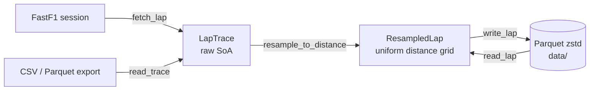

# f1lap

High-performance F1 lap telemetry analyser: ingestion, distance-domain resampling, and delta-time
analysis against a reference lap.



Every lap is mapped onto the same grid (`0, step, 2·step, …` metres), so sample `i` of any two
laps is the same point on track — the basis for delta-time, corner and braking analysis.

## Usage

```sh
uv sync
uv run f1lap fetch 2024 Monza Q LEC            # fastest lap; or --lap 17
uv run f1lap import export.csv --driver VER    # FastF1 or canonical column names
uv run f1lap info data/2024_italian_grand_prix_q_lec_l20.parquet
uv run f1lap corners data/…_qualifying_lec_l20.parquet       # corners located on this lap
uv run f1lap delta data/…_qualifying_lec_l20.parquet data/…_qualifying_sai_l17.parquet --json report.json
```

`delta` puts the compared lap on the reference lap's grid (rescaling its distance to the reference
length), prints the delta at the line and a per-corner table (time per segment, delta, minimum
speed), and optionally writes the same report as JSON. Deltas are `other − reference`:
positive = slower. `--sectors N` uses N equal micro-sectors instead of corners.

### Circuit model

Corners come from, in order: `--circuit file.json`; the circuit `fetch` saved to
`data/circuits/` (FastF1's corner markers); or detection from the reference lap's telemetry
(speed minima ≥ 20 km/h deep; flat-out kinks are skipped). `--detect` forces detection.

FastF1 markers are hand-placed labels, not apexes (Monza's Parabolica marker is 52 m past the
slowest point). Each marker is snapped to the lap's own X/Y line within ±300 m. Corners closer than
150 m form one complex (`T1-2`, `T8-10`); segment boundaries sit midway between complexes.

### Corner phases

In corner mode `delta` also splits every corner into phases and compares the key points:

```
approach | braking | mid | exit | straight
       entry   mid_start  mid_end   full throttle
```

- **entry** — last point at full attack (throttle ≥ 95 %, brake off) before the apex; "braking"
  includes lift-only corners.
- **mid** — the minimum-speed zone: within 5 % of the corner's slowest point. (F1 drivers go
  straight from brake to throttle, so an input-defined mid phase would be ~0 m.)
- **full throttle** — back to full attack after the mid zone.
- Also reported per lap: brake on / release (end of the first braking run), number of brake
  applications, throttle pickup (≥ 20 % with brake off), entry / apex / exit speed.
- Corners taken flat are flagged `flat`.

Phases are cut at the reference lap's boundaries, so phase deltas sum exactly to the corner
delta, and corner deltas to the delta at the line. `--json` includes all points per corner.

Global options (before the subcommand): `--step 0.5` grid spacing, `--length 5793` normalise lap
length, `-o path.parquet`, `--config f1lap.toml`.

```python
from f1lap import resample_to_distance
from f1lap.ingest.fastf1_source import fetch_lap_async  # non-blocking (worker thread)
from f1lap.delta import compare, corner_table, micro_sectors, summary
from f1lap.circuit import corner_segments, detect_corners
from f1lap.phases import analyse_corners, compare_corners
```

## Data model

| Channel | Unit | Kind | Resampling |
|---|---|---|---|
| distance | m | axis | uniform grid |
| time | s | continuous | linear |
| speed | km/h | continuous | linear |
| throttle | 0–100 % | continuous | linear |
| brake | 0–1 | continuous | linear |
| rpm, x, y, z | — | continuous | linear |
| gear, drs | — | discrete (int16) | zero-order hold |

Distance is cleaned first: NaN rows and samples that don't advance past all earlier samples are
dropped (never interpolated through), the lap is shifted to start at 0 m, and gaps over 500 m are
rejected as corrupt. The true lap length is kept in `meta.raw_length_m`; when comparing laps,
resample them with `length_m=<reference raw_length_m>` so grids match exactly.

`brake` is linearly interpolated: FastF1's on/off brake becomes fractional only on the grid point
straddling a transition (onset error ≤ one step). Pressure exports are stored as provided.

Discrete channels: NaN gaps are forward-filled; non-integer or out-of-range values are rejected.

## Configuration

`f1lap.toml` (`[paths] cache_dir, data_dir`, `[resample] step_m`); paths are relative to the
file. Environment overrides: `F1LAP_CACHE_DIR`, `F1LAP_DATA_DIR`, `F1LAP_STEP_M`.

> **Security:** FastF1 stores its HTTP cache as Python pickles. Never point `cache_dir` at a
> cache from an untrusted source — loading it can execute arbitrary code.

## Development

```sh
uv run pytest            # offline suite
uv run pytest -m network # live FastF1 test
uv run ruff check . && uv run mypy src tests
```

## Roadmap

1. ~~Ingestion + distance resampling~~
2. ~~Delta-time trace vs reference lap, micro-sectors~~
3. ~~Corners: circuit model, per-corner delta, braking/mid/exit phases and key points~~
4. Driver metrics: throttle smoothness, full-throttle time, brake onset steepness
5. Lap rating vs the driver's theoretical best and the field
6. Native macOS app UI: interactive traces (speed, delta, throttle/brake, gear), reports.
   The `f1lap` core stays UI-agnostic: typed results + JSON-ready summaries, async I/O.
7. Native kernels (C++/nanobind) where profiling shows NumPy is the bottleneck
