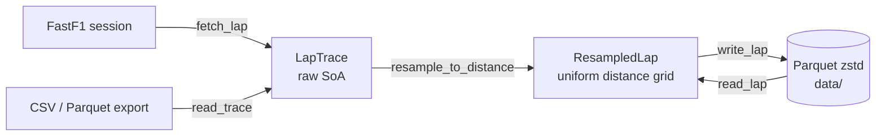
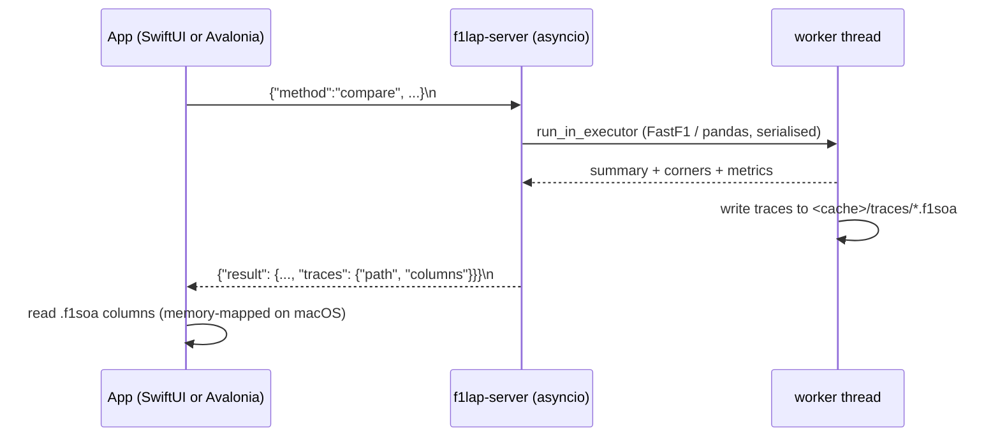

# f1lap

f1lap analyses Formula 1 lap telemetry from [FastF1](https://github.com/theOehrly/Fast-F1). It is
made of three parts: a Python library and command line tool that put laps on a common distance grid
and compare them corner by corner; a desktop app that uses the library as a background process,
native on macOS (SwiftUI) and on Windows (.NET with Avalonia), with the same layout and features
on both; and a web app at [f1-lap-analyser.vercel.app](https://f1-lap-analyser.vercel.app) that
shows the same comparison and rating for recent seasons in the browser, from data the library
precomputes.

With it you can compare any two laps (including laps from different seasons at the same event),
rate a lap against the rest of the field, and measure it against a simulated perfect lap for the
session, with plain-language reasons for where the time went. The app can replay the rated lap
against the perfect lap on the track map, with braking points, slowest points and full-throttle
markers and an optional camera that follows the cars. A "★ Fastest" choice picks the session's
fastest lap without having to know who set it.

## Download

To try it without installing anything, open the web app at
[f1-lap-analyser.vercel.app](https://f1-lap-analyser.vercel.app). It covers the qualifying and race
sessions of 2024 to 2026, using each driver's fastest lap, and has the Compare and Rating tabs.
The desktop apps add every season FastF1 covers, every lap, practice and sprint sessions, and the
ghost replay.

Ready-to-run apps are attached to each [GitHub release](https://github.com/mustafa-hidiroglu/f1-lap-analyser/releases/latest).
They include their own Python and analysis engine, so nothing else needs to be installed.

| Platform | File | Install |
|---|---|---|
| macOS 15+ (Apple Silicon) | `F1Lap-<version>-mac-arm64.dmg` | Open the disk image and drag F1 Lap Analyser to Applications |
| Windows 10/11 (x64) | `F1Lap-Setup-<version>-win-x64.exe` | Run the installer; it installs for the current user, no admin rights needed |

The apps are not code-signed, so the first launch needs one extra confirmation:

- **macOS:** if the app "can't be opened", go to System Settings → Privacy & Security and click
  **Open Anyway**, or run `xattr -dr com.apple.quarantine /Applications/F1Lap.app`.
- **Windows:** if SmartScreen shows "Windows protected your PC", click **More info → Run anyway**.

An internet connection is needed the first time each session is loaded. Downloaded data is kept
in `~/Library/Caches/f1lap` and `~/Library/Application Support/F1Lap` on macOS, and in
`%LOCALAPPDATA%\f1lap` on Windows.

The rest of this README covers building from source and using the Python library and command line
tool.

## Requirements

| Component | Requirement |
|---|---|
| Operating system | macOS 15 or later, or Windows 10/11 (x64 or Arm64), for the app; the Python part also runs on Linux |
| Swift toolchain | Swift 6 (Xcode Command Line Tools; full Xcode is not required), for the macOS app |
| .NET SDK | 8.0, to build the Windows app (running the published `F1Lap.exe` needs no .NET install) |
| Python | 3.13 or later |
| Node.js | 20.9 or later, for the web app |
| Package manager | [uv](https://docs.astral.sh/uv/) |
| Disk space | Several GB for the FastF1 cache if you load many sessions |
| Network | Needed the first time each session is loaded |

Install the Command Line Tools with `xcode-select --install` and uv with `brew install uv` (or
the installer described in the uv documentation). uv downloads a suitable Python if one is not
installed.

## Setup

1. Clone the repository.

   ```sh
   git clone https://github.com/mustafa-hidiroglu/f1-lap-analyser.git
   cd f1-lap-analyser
   ```

2. Create the virtual environment and install the dependencies. This creates `.venv/` in the
   repository, which the command line tool, the tests and development runs of the apps use.

   ```sh
   uv sync
   ```

3. Run the test suite to check the installation. It works offline and finishes in a few seconds.

   ```sh
   uv run pytest
   ```

4. Load a first session, for example Charles Leclerc's fastest lap in 2024 Monza qualifying.

   ```sh
   uv run f1lap fetch 2024 Monza Q LEC
   ```

The first load of a session downloads its timing and telemetry from the FastF1 API, which can
take from several seconds to a few minutes depending on the session and the API's rate limits.
Later loads come from the local cache. The command line tool keeps its cache in `cache/` and
processed laps in `data/` (both set in `f1lap.toml` and neither committed to git). The apps use
their own cache: `~/Library/Caches/f1lap` on macOS, `%LOCALAPPDATA%\f1lap\Cache` on Windows.

On Windows, use PowerShell: install uv with `winget install astral-sh.uv` (or the uv installer), then
run the same `uv sync` and `uv run` commands.

> **Security:** FastF1 stores its HTTP cache as Python pickles. Never point the cache directory at
> a cache from an untrusted source, as loading it can execute arbitrary code.

## Using the command line

All commands run through `uv run f1lap`. Session names are FastF1's short forms (`FP1`, `FP2`,
`FP3`, `Q`, `SQ`, `S`, `R`); events can be given by name or round number. Run
`uv run f1lap <command> --help` for every option.

Download a lap and store it on the distance grid (the driver's fastest lap unless `--lap` is
given):

```sh
uv run f1lap fetch 2024 Monza Q LEC
uv run f1lap fetch 2024 Monza Q SAI --lap 17
```

Compare two stored laps corner by corner. Deltas are compared minus reference, so a positive value
means the compared lap is slower.

```sh
uv run f1lap delta data/2024_italian_grand_prix_qualifying_lec_l20.parquet \
    data/2024_italian_grand_prix_qualifying_sai_l17.parquet --json report.json
```

Rate a lap against the session and the perfect lap:

```sh
uv run f1lap rate 2024 Monza Q LEC
uv run f1lap rate 2024 Monza Q LEC --lap 17 --json rating.json
```

Other commands:

```sh
uv run f1lap import export.csv --driver VER      # resample a CSV or Parquet telemetry export
uv run f1lap info data/<lap>.parquet             # summarise a stored lap
uv run f1lap corners data/<lap>.parquet          # corners located on a stored lap
uv run f1lap metrics data/<lap1>.parquet data/<lap2>.parquet   # driver-input metrics
uv run f1lap simbase list                        # entries and failures in the perfect-lap base
```

Global options go before the command: `--step 0.5` sets the grid spacing in metres,
`--length 5793` normalises the lap length, `-o path.parquet` sets the output file and
`--config f1lap.toml` selects a configuration file.

## Building and running the macOS app

1. Complete the Python setup above. The bundle is built from this checkout's `uv.lock`.

2. Build the app bundle.

   ```sh
   app/scripts/bundle.sh
   ```

   This produces `app/build/F1Lap.app` (a release build with an ad-hoc signature, about 700 MB)
   and prints its path. It copies uv's relocatable Python 3.13 into
   `Contents/Resources/python` and installs f1lap with its locked dependencies there, so the app
   runs from anywhere, without this checkout.

3. Open it, or copy it to `/Applications` first if you prefer.

   ```sh
   open app/build/F1Lap.app
   cp -R app/build/F1Lap.app /Applications/
   ```

4. Optionally, package it as a drag-to-Applications disk image
   (`app/build/F1Lap-<version>-mac-arm64.dmg`).

   ```sh
   app/scripts/dmg.sh 0.1.0
   ```

The app starts its sidecar from, in order: the checkout in `F1LAP_REPO` (its `.venv`), the Python
embedded in the bundle, or the checkout it was built from (a bare `swift run`). The bundled
sidecar keeps its cache in `~/Library/Caches/f1lap` and its data in
`~/Library/Application Support/F1Lap`, so nothing is written inside the signed bundle.

The scripts source `app/scripts/env.sh`, which sets `DEVELOPER_DIR` to
`/Library/Developer/CommandLineTools` unless it is already set. Building with the Command Line
Tools means you do not have to accept the Xcode licence, even if Xcode is installed. The same file
adds the search paths for Swift Testing, which the Command Line Tools ship outside the default
location.

To run the Swift tests:

```sh
app/scripts/test.sh
```

Tests that talk to a real sidecar run only when `.venv/` exists; they use the repository's
`cache/`.

If the window is narrower than the sidebar plus the detail column (760 pt), showing the sidebar
widens the window rather than clipping the sidebar.

## Building and running the Windows app

The Windows app (`windows/`) has the same layout and features as the macOS app: the sidebar,
lap pickers, synced traces, the track map coloured by delta, the corner table, the rating report
and the ghost replay. It is a native Win32 application (.NET 8 with Avalonia), not a web view, and
it runs the same Python sidecar.

1. Complete the Python setup above in PowerShell (`uv sync`). A plain build runs
   `.venv\Scripts\python.exe -m f1lap.server` from this checkout; step 5 embeds Python instead.

2. Install the [.NET 8 SDK](https://dotnet.microsoft.com/download/dotnet/8.0)
   (`winget install Microsoft.DotNet.SDK.8`).

3. Build the app.

   ```powershell
   windows\scripts\publish.ps1            # x64; add -Arch arm64 for Windows on Arm
   ```

   This produces `windows\dist\F1Lap\F1Lap.exe`, a single self-contained executable, and prints its
   path. It is unsigned (personal use), so SmartScreen may ask you to confirm the first launch.

4. Run it, or pin it to the Start menu or the taskbar.

   ```powershell
   windows\dist\F1Lap\F1Lap.exe
   ```

5. Optionally, make it self-contained and build the installer. `bundle-python.ps1` copies uv's
   relocatable Python into `windows\dist\F1Lap\python` and installs f1lap with its locked
   dependencies there; [Inno Setup 6](https://jrsoftware.org/isinfo.php) then packages the folder
   as `windows\dist\F1Lap-Setup-<version>-win-x64.exe`.

   ```powershell
   windows\scripts\bundle-python.ps1
   iscc /DAppVersion=0.1.0 windows\installer\F1Lap.iss
   ```

The app looks for its sidecar in `F1LAP_REPO` if set, then in the embedded `python\` folder next
to `F1Lap.exe`, then in the checkout it was built from, then in the folders above the executable.
The embedded sidecar keeps its cache and data in `%LOCALAPPDATA%\f1lap`.

To build it from macOS or Linux instead, run `windows/scripts/publish.sh` (the result is the same
`.exe`). For development, `dotnet run --project windows/F1Lap.App` runs the app on the current
platform. The `F1LAP_*` development variables listed under [Development](#development) work in
both apps.

Keyboard: Ctrl+Enter compares; Ctrl+Shift+S shows or hides the sidebar. Drag the window by its toolbar;
double-click the toolbar to maximize it.

## Building and deploying the web app

The web app in `web/` is a static [Next.js](https://nextjs.org) site with no server: `next build`
writes plain files to `web/out/`, and the browser does the drawing. It reads precomputed data
from `web/public/data/`, which `tools/web_export.py` writes with the same library the desktop apps
use. The data is not committed (about 64 MB for 2024 to 2026), so it has to be exported before
building.

1. Export the sessions. This loads every session through FastF1, so it takes a while the first
   time; it is resumable, skipping sessions already on disk unless `--force` is given:

   ```sh
   uv run python tools/web_export.py --years 2024 2025 2026
   ```

   FastF1 allows 500 API calls an hour. A season is about 48 sessions and fits under that limit,
   but if `RateLimitExceededError` shows up, wait an hour and run the same command again. Sessions
   that fail are listed under `failures` in `web/public/data/index.json`.

2. Install, test and build:

   ```sh
   cd web
   npm ci
   npm test                         # includes parity tests against the Python output
   npm run build                    # writes web/out/
   npm start                        # serves web/out/ on a local port
   ```

3. Deploy the built folder to Vercel. Because the data is not in Git, a Git-triggered Vercel build
   would have no data, so deploy `web/out/` from your machine with the Vercel CLI, including
   `vercel.json` for its clean URLs and cache headers:

   ```sh
   cp vercel.json out/
   npx vercel deploy --prod --cwd out
   ```

## Using the app

The macOS and Windows apps have the same layout and controls; only the shortcuts differ.

| Action | macOS | Windows |
|---|---|---|
| Compare | Command-Return | Ctrl+Enter |
| Show or hide the sidebar | toolbar button | toolbar button, or Ctrl+Shift+S |

1. Choose a season, an event and a session in the sidebar. The session's drivers and laps load in
   the background; a progress message shows while data is downloaded.

2. Choose the **Reference** and **Compared** laps. For each side, pick a driver, or "★ Fastest"
   for the session's fastest valid lap, then a lap number ("Fastest" is the driver's best lap;
   invalid laps are marked ✕). The season menu next to the compared lap takes it from the same
   event in another season.

3. Press **Compare**.

The **Compare** tab shows speed, delta, throttle and brake, and gear traces against distance, a
track map coloured by where time is gained and lost, and a per-corner table. Hovering over a chart
moves a pointer across every chart and the track map; dragging across a chart zooms all of them to
that stretch (**Show full lap** zooms back out). Selecting a corner row zooms the traces to that
corner. The divider between the charts and the track map can be dragged.

The window never cuts off part of the layout. In a narrow window the lap pickers wrap onto two
rows, and showing the sidebar widens the window instead of clipping the sidebar. On Windows, a
maximized window on a small screen hides the sidebar when both columns can't fit.

The **Rating** tab rates either the reference or the compared lap (chosen with the segmented
control, then **Rate**). It shows the score, the time lost per corner against the driver's own best
and the session's best, and a section headed "vs the perfect lap" with the gap, the reasons for
each corner, and a speed trace against the simulated lap.

### Ghost replay

Below the perfect-lap report, the ghost replay runs the rated lap and the perfect lap as two cars
on the track map.

| Control | Effect |
|---|---|
| Play / Pause | Starts or stops the replay |
| 1× / 2× / 4× | Playback speed |
| Slider | Scrubs through the lap; playback pauses while you drag |
| Markers | Shows braking points, slowest points and full-throttle points |
| Follow | Zooms to a window of about 400 m around the two cars |

The readout shows the replay clock, the gap between the cars, and each car's speed and current
phase (braking, lift or part throttle, full throttle, accelerating, steady). Each car shows its lap
time once it crosses the line.

The markers mean the following:

- **Braking point** (bar across the line): where the car starts a braking zone. Braking zones are
  found from each car's speed trace (deceleration of at least 0.5 g that sheds at least 10 km/h).
  The simulation has no pedal model, so the perfect car's marker is the start of that deceleration.
  The rated car's marker is where the driver presses the brake pedal, so it matches the moment its
  dot turns red. A corner taken with a lift and no braking has no marker for the rated car.
- **Slowest point** (ring): the minimum speed of each braking zone.
- **Full throttle** (dot, rated car only): where the driver is back at 95 % throttle or more after
  the slowest point, taken from the throttle pedal.

Both cars follow the same line. FastF1 positions are snapped to a single track path, so the replay
shows where along the lap time is gained or lost, not a different racing line.

## How it works



Every lap is mapped onto the same grid (`0, step, 2·step, …` metres), so sample `i` of any two
laps is the same point on track. This is the basis for delta time, corner and braking analysis.
`delta` puts the compared lap on the reference lap's grid, rescaling its distance to the reference
length. `--sectors N` uses N equal micro-sectors instead of corners.

### Circuit model

Corners come from, in order: `--circuit file.json`; the circuit that `fetch` saved to
`data/circuits/` (FastF1's corner markers); or detection from the reference lap's telemetry
(speed minima at least 20 km/h deep, skipping flat-out kinks). `--detect` forces detection.

FastF1's markers are hand-placed labels, not apexes (Monza's Parabolica marker is 52 m past the
slowest point), so each marker is snapped to the lap's own X/Y line within 300 m. Corners closer
than 150 m form one complex (`T1-2`, `T8-10`), and segment boundaries sit midway between
complexes.

### Corner phases

In corner mode, `delta` also splits every corner into phases:

```
approach | braking | mid | exit | straight
       entry   mid_start  mid_end   full throttle
```

- **Entry** is the last point at full attack (throttle at least 95 %, brake off) before the apex.
  The braking phase includes lift-only corners.
- **Mid** is the minimum-speed zone, within 5 % of the corner's slowest point. F1 drivers go
  straight from brake to throttle, so a phase defined by pedal inputs would be close to 0 m long.
- **Full throttle** is the return to full attack after the mid zone.
- Each lap also reports brake on and release, the number of brake applications, throttle pickup
  (20 % or more with the brake off), and entry, apex and exit speeds. Corners taken flat are
  flagged `flat`.

Phases are cut at the reference lap's boundaries, so phase deltas sum exactly to the corner delta,
and corner deltas to the delta at the line. `--json` includes every point per corner.

### Lap rating

`rate` compares one lap with every valid lap in the session (accurate, not deleted, no pit in or
out, within 107 % of the fastest), all cut into the same corner segments on the session's fastest
lap:

- **Theoretical best**: the driver's best time in each segment, summed. The lap time minus the
  theoretical best is the time left on the table, and the table shows which lap set each personal
  best.
- **Session ultimate**: the best time in each segment by anyone, and who set it.
- **Rank and percentile** per corner against every other driver's best in that corner.
- **Score** (0 to 100): the mean corner percentile. Seconds are the primary result; the score is a
  scale-free summary for ranking laps and drivers.

Segment times add up to the official lap time, because the last segment is extended from the end of
the grid to the finish line (checked to 0.0 ms on all 87 valid laps of 2024 Monza qualifying).
Applications should call `await rating.rate_fastf1_lap_async(...)`, which returns a typed
`LapRating` (`.to_dict()` for JSON).

### Perfect lap and reasons

`rate` also compares the lap with the session's perfect lap, a physics simulation, and explains in
plain sentences where and why it was slower:

```
BOT L2 was 2.904 s slower than the perfect lap; the session's best laps were typically 1.253 s
off it, so this lap left 1.651 s on the table.
T1-2: carried 7 km/h less through the apex than the best laps; the deficit carries onto the exit (0.41 s).
T11: carried 19 km/h less through the apex than the best laps; the deficit carries onto the exit (0.25 s).
```

- **Simulation** (`sim.py`): a quasi-steady-state point mass on the session's fastest lap. The
  corner speed limit at each point is the best speed any of the 8 fastest laps reached there
  (after warping the laps onto one line by X/Y, since integrated distance drifts by 10 to 30 m).
  Braking and acceleration come from fitted car envelopes (downforce-dependent braking,
  power- and drag-limited acceleration) and are never below what a calibration lap demonstrated at
  that point. The result is typically 1 to 4 % faster than pole.
- **One perfect lap per session** (qualifying, sprint qualifying or shootout, sprint, race), so
  race laps are judged against race pace. Sessions whose simulation fails the sanity check (0 to
  8 % faster than the fastest lap) or that have fewer than 3 timed laps get none, with the reason.
- **Reasons** (`explain.py`) judge the lap against the best laps' typical loss to the perfect lap,
  not against the perfect lap itself: braking early or late, lift and coast, apex speed, a slow
  exit, a slower approach, and context such as cars within 1 s ahead (dirty air or a fight),
  positions gained or lost, a car behind at the line, yellow, SC or VSC flags, pit laps, tyre age
  and race fuel. Each corner phase's excess time is claimed by at most one reason.
- **Base**: `src/f1lap/simbase/<year>/<event>__<session>.parquet` (about 45 KB each). The base is
  prebuilt for 2018 to 2026 (421 sessions, about 18 MB) and ships with the package. Sessions
  missing from it are simulated on demand and saved to `<cache_dir>/simbase/`.

To rebuild or extend the base:

```sh
uv run f1lap simbase build --years 2018-2026      # resumable, about 4 s per session once cached
uv run f1lap simbase build --years 2026 --retry-failed
uv run f1lap simbase list
```

The builder uses its own FastF1 cache (`<cache_dir>/simbase-build` by default), frees each session
after building it, waits out API rate limits, and leaves sessions with network errors for the next
run.

### Driver metrics

`metrics` reports, side by side for each lap:

- **Lap**: time-weighted share at full throttle (95 % or more), braking, and coasting (throttle
  under 10 %, brake off), and ramp-weighted throttle smoothness.
- **Corner exits**: throttle smoothness (net rise divided by total throttle movement from the final
  pickup to full throttle, where 1.0 is one clean push), ramp time and rate, and lifts (drops of
  more than 10 points). A chicane's first corner is excluded.
- **Braking zones**: peak deceleration (g) and its 10 to 90 % rise time. FastF1's brake channel is
  on or off, so deceleration comes from the speed trace, differentiated over ±0.25 s to match
  FastF1's speed sampling of about 4 Hz (Monza T1 is about 5 g). The window widens rise times by
  up to about 0.5 s, so compare them between laps from the same source rather than reading them as
  absolute values.
- **Brake pressure** exports (most braking samples between 0 and 1) are detected automatically.
  Braking then starts at 5 % of peak pressure, and the 10 to 90 % pressure rise time is reported.

The main library entry points:

```python
from f1lap import resample_to_distance
from f1lap.ingest.fastf1_source import fetch_lap_async  # non-blocking (worker thread)
from f1lap.delta import compare, corner_table, micro_sectors, summary
from f1lap.circuit import corner_segments, detect_corners
from f1lap.phases import analyse_corners, compare_corners
```

### Data model

| Channel | Unit | Kind | Resampling |
|---|---|---|---|
| distance | m | axis | uniform grid |
| time | s | continuous | linear |
| speed | km/h | continuous | linear |
| throttle | 0 to 100 % | continuous | linear |
| brake | 0 to 1 | continuous | linear |
| rpm, x, y, z | | continuous | linear |
| gear, drs | | discrete (int16) | zero-order hold |

Distance is cleaned first. Rows with NaN and samples that do not advance past all earlier samples
are dropped (never interpolated through), the lap is shifted to start at 0 m, and gaps over 500 m
are rejected as corrupt. The true lap length is kept in `meta.raw_length_m`; when comparing laps,
resample them with `length_m=<reference raw_length_m>` so the grids match exactly.

`brake` is linearly interpolated, so FastF1's on/off brake becomes fractional only on the grid
point straddling a transition (onset error of at most one step). Pressure exports are stored as
provided. In discrete channels, NaN gaps are forward-filled, and non-integer or out-of-range values
are rejected.

### App sidecar

Both apps run `f1lap.server` as a child process and talk JSON-RPC 2.0 to it over stdin and stdout,
one message per line. No network port is opened. On Windows, whose asyncio loop cannot attach to
the anonymous pipes a parent hands its child, the server reads stdin on a thread and writes replies
through an ordered writer thread; the event loop still never blocks.



| Method | Params | Result |
|---|---|---|
| `ping` | | protocol version, cache directory |
| `schedule` | `year` | events with round, date, format and session names |
| `session` | `year, event, session` | drivers (team, colour, position) and every lap with its validity |
| `compare` | session, plus `reference` and `other`: `{driver, lap?, year?, event?, session?}` | delta summary, corner table, phases, metrics for both laps, circuit, trace file |
| `rate` | session, plus `driver, lap?` | `LapRating.to_dict()`, circuit, reference lap, and `perfect` (gap, reasons per corner, summary, trace file; `{"error"}` when the session has no perfect lap) |

- In `compare`, a side's own `year`, `event` or `session` overrides the top-level session (for
  example, one driver across seasons). The reference session supplies the circuit.
- Long requests send `progress` notifications without an `id`: `{"message", "done"?, "total"?}`.
- Errors use the standard JSON-RPC codes, with `-32000` for analysis failures (unknown driver,
  missing data). Non-finite numbers are sent as `null`.
- The event loop never blocks. FastF1 work runs on one worker thread, so `ping` answers while a
  session loads. The 3 most recent sessions stay loaded with their resampled laps memoised (the
  first `rate` of a session takes about 1 s for qualifying and 12 s for a race, later ones about
  20 ms).
- `.f1soa` trace files are Structure-of-Arrays: each column is contiguous little-endian `f64` or
  `i16` at an 8-byte-aligned offset, described by `columns: [{name, dtype, offset, count}]`. The
  20 newest files are kept.
- The cache defaults to `~/Library/Caches/f1lap` on macOS, `%LOCALAPPDATA%\f1lap\Cache` on
  Windows and `$XDG_CACHE_HOME/f1lap` elsewhere (`--cache-dir` or `F1LAP_CACHE_DIR`).

## Configuration

`f1lap.toml` holds `[paths] cache_dir, data_dir` and `[resample] step_m`. Paths are relative to the
file. The environment variables `F1LAP_CACHE_DIR`, `F1LAP_DATA_DIR` and `F1LAP_STEP_M` override
them.

## Development

```sh
uv run pytest                      # offline suite
uv run pytest -m network           # tests against the live FastF1 API
uv run ruff check .
uv run mypy src tests
app/scripts/test.sh                # Swift tests
dotnet test windows/F1Lap.Core.Tests    # Windows app core tests (shares the Swift fixtures)
(cd web && npm test)               # web app tests (parity tests need web/public/data)
uv run python app/scripts/fixtures.py   # regenerate Swift test fixtures (needs cache/)
```

Both apps read a few environment variables that help during development. Run the binary directly
so that they reach it:

```sh
F1LAP_OPEN=2024/Monza/Qualifying/LEC/SAI app/build/F1Lap.app/Contents/MacOS/F1Lap
```

```powershell
$env:F1LAP_OPEN = "2024/Monza/Qualifying/LEC/SAI"; windows\dist\F1Lap\F1Lap.exe
```

- `F1LAP_OPEN=YEAR/EVENT/SESSION/REF/OTHER[/rating]` opens a session and compares the two drivers'
  fastest laps. `fastest` in place of a driver code picks the session's fastest lap.
  `OTHER@YEAR` (for example `HAM@2025` or `fastest@2025`) takes the compared lap from the same
  event in another season. A trailing `/rating` opens the Rating tab.
- `F1LAP_SNAPSHOT=shot.png` writes the window to a PNG once results have loaded, then quits.
- `F1LAP_SNAPSHOT_SIZE=1600x1000` resizes the window before the snapshot.
- `F1LAP_SNAPSHOT_SIDEBAR=reopen` hides the sidebar, resizes the window, then shows the sidebar
  again before the snapshot (checks that a narrow window never clips the sidebar).
- `F1LAP_REPO=/path/to/checkout` runs the sidecar from another checkout's `.venv` (this also
  overrides the Python embedded in a bundled app).

### Releases

`.github/workflows/release.yml` builds both apps on native GitHub runners (macOS 15 and Windows),
checks that each embedded sidecar answers `ping`, and packages the `.dmg` and the installer.
Pull requests that touch the apps or the Python package run the same build and attach the files
to the workflow run without publishing anything. Pushing a version tag from `master` publishes a
GitHub release with both files:

```sh
git tag v0.2.0 && git push origin v0.2.0
```

The app icon's source is `assets/brand/f1lap-icon.svg`, "Pulse": one speed trace through one
corner that dives toward the apex (the red dot) and bends around it without touching. The other
concepts it was chosen from are in `design/logo-concepts/`. After changing it, render
`assets/brand/f1lap-icon-1024.png` and run `assets/brand/build-icons.sh`, which writes the
committed `app/Resources/F1Lap.icns` (app and disk image) and `windows/F1Lap.App/F1Lap.ico`
(exe, window and installer). The web app uses the same icon as `web/app/icon.svg`,
`apple-icon.png` and `favicon.ico`.

## Roadmap

Done: ingestion and distance resampling; delta time and micro-sectors; circuit model, per-corner
deltas and phases; driver metrics; lap rating; the macOS app; the perfect lap with reasons and the
ghost replay; the Windows app; self-contained macOS and Windows releases; the web app.

Planned: native kernels (C++ with nanobind) where profiling shows NumPy is the bottleneck.

## Data and credits

Timing and telemetry data come from the FastF1 library
([github.com/theOehrly/Fast-F1](https://github.com/theOehrly/Fast-F1)) and belong to their
respective owners, including Formula 1. The web app serves lap data precomputed from them. This
project is unofficial and is not associated with
Formula 1 or any of its companies. F1, FORMULA ONE and related marks are trademarks of Formula One
Licensing B.V.

## License

f1lap is released under the [MIT License](LICENSE). Copyright © 2026 Mustafa Can Hidiroglu.

The released apps bundle third-party software under its own licenses, including Python (PSF
License), FastF1 (MIT), NumPy and SciPy (BSD-3-Clause), pandas (BSD-3-Clause), Polars (MIT),
PyArrow (Apache-2.0), Matplotlib (Matplotlib License), Requests (Apache-2.0), .NET (MIT) and
Avalonia (MIT). Their license files ship inside the bundled Python environment.

The web app uses Next.js, React and Phosphor Icons (all MIT), whose licenses are in
`web/node_modules` after `npm ci`. The MIT License covers the code in this repository only, not
the timing and telemetry data the web app serves (see [Data and credits](#data-and-credits)).
