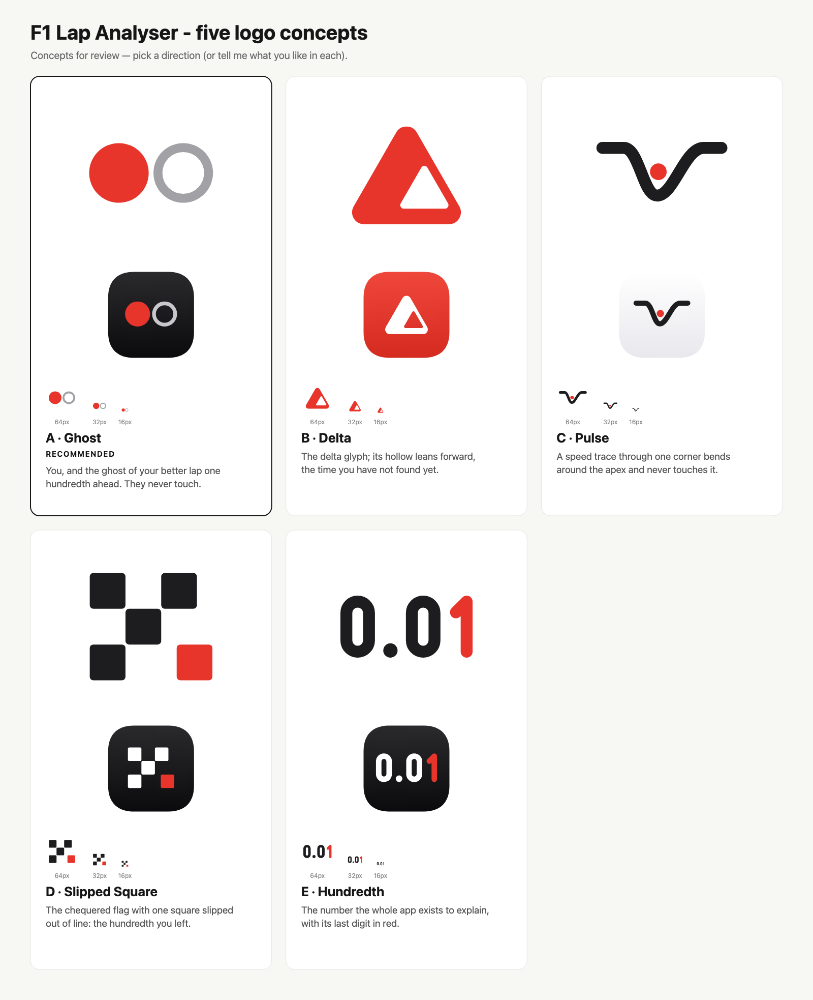
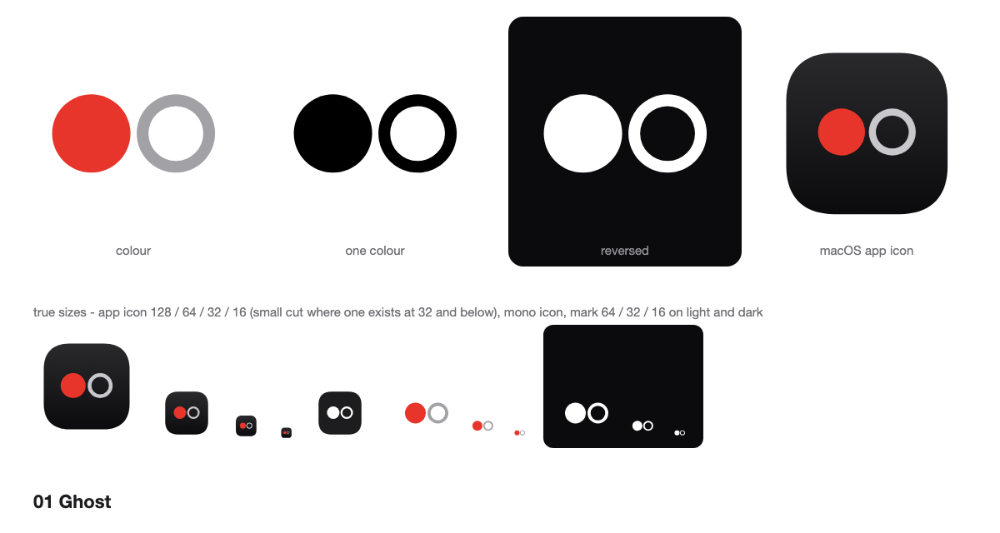
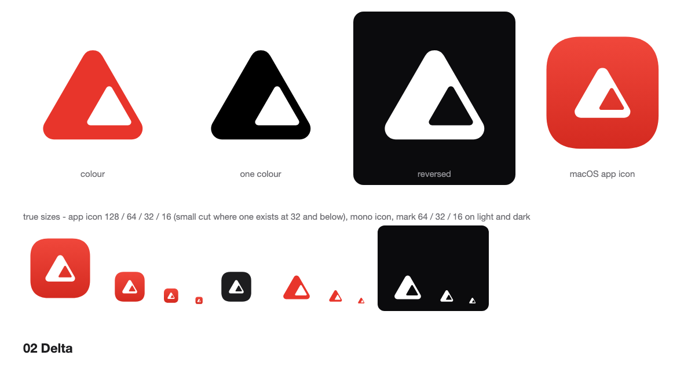
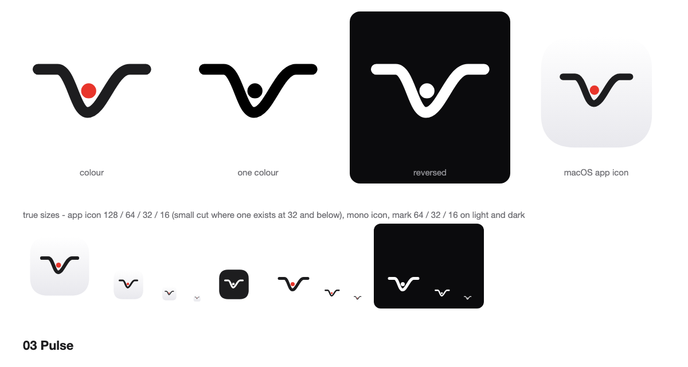
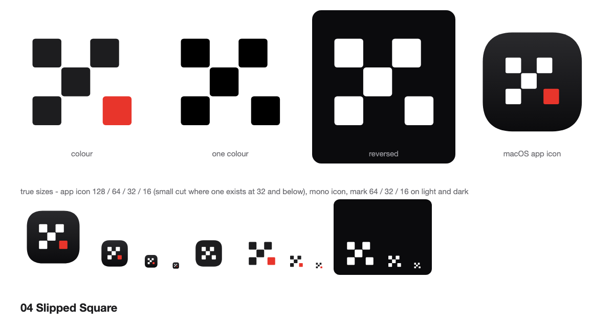
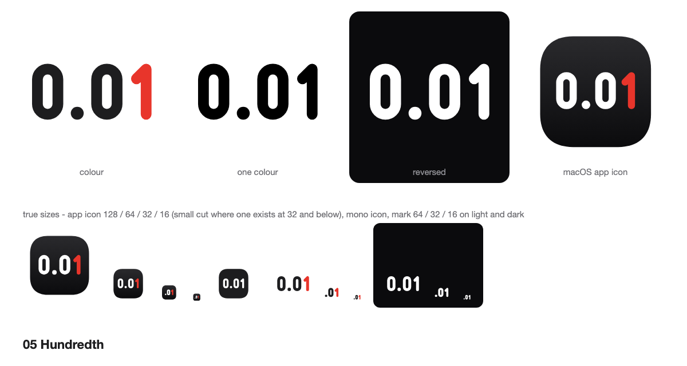

# F1 Lap Analyser: logo concepts, round 1

These are five proposals for a new mark. None of them replaces anything yet: the shipping icon is still
`assets/brand/f1lap-icon.svg` (two racing lines through one corner, in blue and orange).

**Brief:** "Tell a story, be kind of simple and emotionally complicated, and feel as if F1 and Apple had a child."

- **Story:** each mark carries a small narrative about the chase for a lap that never quite exists.
- **Simple:** two to five primitives per mark, one idea each. Every mark is tested at 16 px, in one colour and reversed.
- **Emotionally complicated:** each mark holds a near miss, a gap, an absence or a second reading.
- **F1 × Apple:** racing ideas (ghost car, delta, speed trace, chequered flag, timing screen) drawn with Apple
  restraint: soft geometry, lots of empty space, a continuous-curvature squircle tile and a small palette.
- **Avoided:** cars, helmets, steering wheels, fruit, F1 or Apple trademarks, and the current icon's idea of
  two racing lines through a corner.

**Palette:** Apex red `#E8352B` (warmer than a flag red), graphite `#1D1D1F`, ghost silver `#A1A1A6`, paper
`#F5F5F7` and ink `#0B0B0D`. The app icons put each mark on a macOS Big Sur grid tile (824 of 1024, with
continuous corners). The tile has a faint vertical gradient, and every other file is flat colour.

---

## 01 Ghost (abstract, two primitives): recommended

**Story:** On the timing screen there is always a ghost: the perfect lap, a car that isn't really there. The solid
red disc is you. The silver ring is the same size, a hundredth of a second ahead, and it is you as well, the lap
you could have driven. They come as close as two things can and never touch.

**Simple:** It is one circle, one ring and one gap, so it reads at 16 px and in one colour without any special cut.

**Emotionally complicated:** Something present sits next to something absent. The thing you are chasing is
yourself, and the gap is the whole point: closing it would end the story.

**F1 × Apple:** The ghost car is how F1 broadcasts show the chase. The form is pure Apple: two perfect circles,
lots of air and a dark squircle.

**Risk:** In a row of system icons it could be mistaken for a toggle or a record/stop control. The red and the
size of the gap are what make it ours.

## 02 Delta (letterform / glyph)

**Story:** Δ is the one symbol every timing screen shares: the difference. This delta's hollow has drifted forward.
The trailing side is heavy and the leading side is a hairline away from breaking open. The empty space inside is
the time you haven't found yet.

**Simple:** It is a single filled shape with one hole.

**Emotionally complicated:** The hollow is off centre, so the shape looks almost wrong. The mark is literally
built around something missing.

**F1 × Apple:** It uses the broadcast's delta language in a soft, filleted form, as a white glyph on an Apex-red
squircle.

**Risk:** Rounded triangles can read as a warning sign, and at 16 px the off-centre hollow is the only cue.

## 03 Pulse (line mark drawn from the product's own data)

**Story:** Every corner leaves the same trace in speed: flat out, a hard stab of braking, then the long climb back.
The line dives toward the apex, the red dot, and bends around it without touching. A corner is a held breath.

**Simple:** It is one line and one dot.

**Emotionally complicated:** It reads as a speed trace, a heartbeat and a held breath at once. Some people also
see a small figure throwing their arms up, which could be triumph or a fall.

**F1 × Apple:** It is the app's own speed chart reduced to a single stroke, drawn in graphite on paper like an
Apple Health glyph.

**Risk:** It is the weakest at 16 px (it turns into a tick), and it is stroke-based, so a final version needs outlined strokes.

## 04 Slipped Square (pattern / heritage)

**Story:** This is the chequered flag reduced to nine squares, five of them dark. One square has slipped forward
and out of line, in red. It stands for the hundredth you left on track: the race is over but the grid is not quite right.

**Simple:** It is five identical rounded squares, the most systematic of the set, and it extends easily into
patterns, loaders and icons.

**Emotionally complicated:** The flag means it's finished, yet the slipped square means it isn't. Look again and
it is also a die showing five, which sets precision against luck.

**F1 × Apple:** It uses the sport's oldest symbol exactly once, as a calm grid of squircles on an ink tile.

**Risk:** In one colour the slip carries the idea alone, so the 26-unit offset must never be "corrected".

## 05 Hundredth (numeric wordmark-as-symbol)

**Story:** Everything the app does, including the traces, the coloured map and the simulated perfect lap, is the
long answer to one number. Here that number is the logo: `0.01`, with the last digit in red.

**Simple:** It is four constructed glyphs (two stadium zeros, a dot and a one) with one weight and one radius.
`mark-small.svg` and `app-icon-small.svg` are a `.01` cut with heavier strokes for 16 to 32 px.

**Emotionally complicated:** It is the smallest number carrying the greatest weight, the margin between pole and
P2. It is not a boast and not a lament, just an exact measure of the regret.

**F1 × Apple:** Timing-tower numerals, drawn soft and round in the spirit of SF Rounded (constructed from paths,
not a font).

**Risk:** It is the most literal of the five, and it needs the separate small cut below 32 px.

---

## Recommendation

**01 Ghost.** It is the simplest form with the deepest story. It is the app's purpose, chasing a better version of
a lap, in one glance. It needs no small-size cut, survives one colour and reversal unchanged, sits naturally in
a macOS dock and grows into a system: the disc and ring can mark the reference and compared laps in the UI, the
gap can animate as the delta, and the ring can fill in when a lap beats the simulated perfect lap.
**Hundredth** is the strongest alternative if you want something more literal and typographic.

## Tests run

- `svg_audit.py` on every master: no warnings. Info notes only:
  - Ghost and Pulse are wide shapes inside a square canvas.
  - Pulse and Hundredth are stroke-based concept files; outline the strokes before production.
  - Delta deliberately sits 4 units high, at the optical centre of an apex-up triangle.
  - The app icons carry a single, intentional tile gradient. The `-mono` icons are flat.
- `preview_sheet.py` (true-size ladder, 16/32/48 px pixel test, backgrounds, greyscale, blur, mirror and 180°):
  `test-sheet.html` / `test-sheet.png`.
- Every `preview.png` shows colour, one colour, reversed, the app icon and the mono icon at 128/64/32/16 px, plus
  the mark at true 64/32/16 px on light and dark.

## Files

| File | What it is |
|---|---|
| `NN-name/mark.svg` | Colour master on a 256 grid with a transparent background |
| `NN-name/mark-mono.svg`, `mark-reversed.svg` | One colour in black, and in white for dark backgrounds |
| `NN-name/mark-on-dark.svg` | Colour version for dark backgrounds |
| `NN-name/app-icon.svg`, `app-icon-mono.svg` | macOS squircle app icon, in colour and in one colour |
| `05-hundredth/mark-small.svg`, `app-icon-small.svg` | Small-size `.01` cut |
| `NN-name/preview.png`, `mark-512.png`, `app-icon-512.png` | Rendered previews |
| `concepts.png` / `.svg` | One-page overview of all five concepts |
| `board.html`, `board/slide-NN.png` | Presentation board: brief, each concept with six mockups (app icon, browser tab, website, README, sticker, T-shirt), side by side, recommendation |
| `test-sheet.html` / `.png` | Small-size, one-colour and context tests |
| `build.py`, `board-spec.json` | Regenerate everything (`python3 build.py`, then the logo-design skill's render and board scripts) |

Trademark clearance has not been checked. Run a professional search before adopting any of these.
